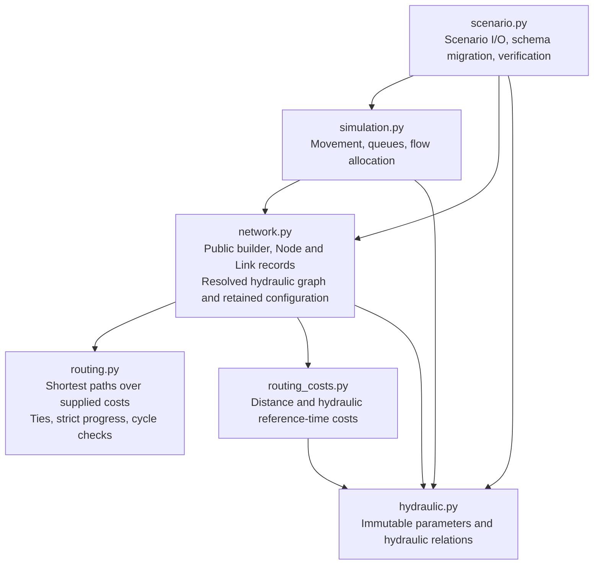

[](https://github.com/PedestrianDynamics/jupedsim-network/actions/workflows/ci.yml)
[](https://codecov.io/gh/PedestrianDynamics/jupedsim-network)
[](https://pedestriandynamics.org/jupedsim-network/)
[](LICENSE)
[](https://pypi.org/project/jupedsim-network/)
[](https://pypi.org/project/jupedsim-network/)

# jupedsim-network


A coarse network egress model for fast estimates of evacuation times
(pre-movement plus movement). Rooms, corridors and stair flights are
nodes with an area; doors and stair entries are links with a flow
capacity. Agents move
through the graph by relations adapted from the SFPE hydraulic model. A run of a
ten-storey building takes about 0.1 s, so scenarios can be sampled many
times.

The package is a companion to [JuPedSim](https://www.jupedsim.org): use
the network model to screen scenarios and find critical cases, and the
microscopic models of JuPedSim to check geometry details. It depends only
on NumPy.

The model is a prototype. It is verified against hand calculations but
not validated against experiments, and it is not intended for
regulatory or design use; see the
[limitations](https://pedestriandynamics.org/jupedsim-network/docs/limitations/).

## Model architecture

The architecture introduced by [routing extraction (#69)](https://github.com/PedestrianDynamics/jupedsim-network/pull/69)
and [hydraulic configuration (#70)](https://github.com/PedestrianDynamics/jupedsim-network/pull/70)
separates the following responsibilities. Arrows point from a module to a
runtime dependency; supporting modules and type-only imports are omitted.



`Network` owns the authoritative graph and retains its immutable hydraulic
configuration alongside resolved node speeds and link capacities. Routing
algorithms receive edge costs and do not depend on hydraulic equations.
Construction, reference-time costs, and movement use the network's retained
configuration. Scenario I/O reconstructs from configuration and construction
inputs; resolved snapshots verify those values rather than override them.
Construction-input recording remains in `Network`.

## How jupedsim-network is built

jupedsim-network is a research code written and maintained by
researchers in pedestrian dynamics who use it in their own work. It is
developed with generative AI coding tools (Claude Code; see
[AI_USAGE.md](AI_USAGE.md)). The AI tools are development aids, not
scientific authors. The named authors are responsible for the model, the
results and the maintenance; the maintainer decides what goes in, every
default, what merges and what ships.

## Install

Python 3.10 or later:

```
pip install jupedsim-network
```

The install provides the `jupedsim-network` command, which runs a
scenario written as a JSON file
([Command line](https://pedestriandynamics.org/jupedsim-network/docs/using/command-line/)):

```
jupedsim-network init
jupedsim-network run scenario.json
pip install "jupedsim-network[cli]"  # coloured --help
pip install "jupedsim-network[tui]"  # terminal UI
jupedsim-network tui scenario.json
```

The terminal UI edits, checks and runs a scenario file in forms
([Terminal UI](https://pedestriandynamics.org/jupedsim-network/docs/using/terminal-ui/)).

## Development

```
uv sync
uv run --extra cli --extra tui --group tui-test pytest
uv run ruff check . && uv run ruff format --check .
```

The pytest command runs the tests of every pull request, as CI does on
Python 3.13 (there with a coverage gate of 97 %). In a fresh
environment, without `--extra tui --group tui-test`, the tests of
`tests/test_tui.py` are skipped: the pilot flows and the 12 SVG
snapshots of the terminal UI. This is the Python 3.10 leg of CI,
`uv run --extra cli pytest`. Without `--extra cli` the tests of the
coloured help are skipped too. The weekly job `tui` of
`.github/workflows/fuzz.yml` runs the terminal UI tests on Python 3.10 as well.

After an intended change of the terminal UI, update the snapshots:

```
uv run --extra cli --extra tui --group tui-test pytest --snapshot-update
```

Five of these SVGs are also the figures of the Terminal UI page.

The pytest command deselects the long tests. Two further commands run
those:

```
uv run --extra cli pytest -m slow
uv run pytest -m fuzz --hypothesis-profile=fuzz
```

The first runs the documented numbers of long runs (CI job
`docs-numbers`); the second runs the long property runs and fixed-seed
sweeps of `.github/workflows/fuzz.yml`, weekly and on demand. See
[Verification](https://pedestriandynamics.org/jupedsim-network/docs/verification/#tests).

The documentation is a [Hugo](https://gohugo.io) site with the
[Hextra](https://imfing.github.io/hextra/) theme in `site/`. Hugo
(extended) and Go are needed to build it:

```
uv run --group docs python scripts/figures/make_figures.py
uv run --group docs python scripts/figures/make_gifs.py
uv run --group docs python scripts/figures/copy_tui_snapshots.py
cd site && hugo server
```

The figures and animations are not stored in git. The first two scripts
write them to `site/static/images/network/` (a few minutes); the third
copies the terminal UI snapshots from `tests/__snapshots__/test_tui/`
to `site/static/images/tui/`. CI runs them before every build.

## License

LGPL-3.0-or-later, as JuPedSim.
